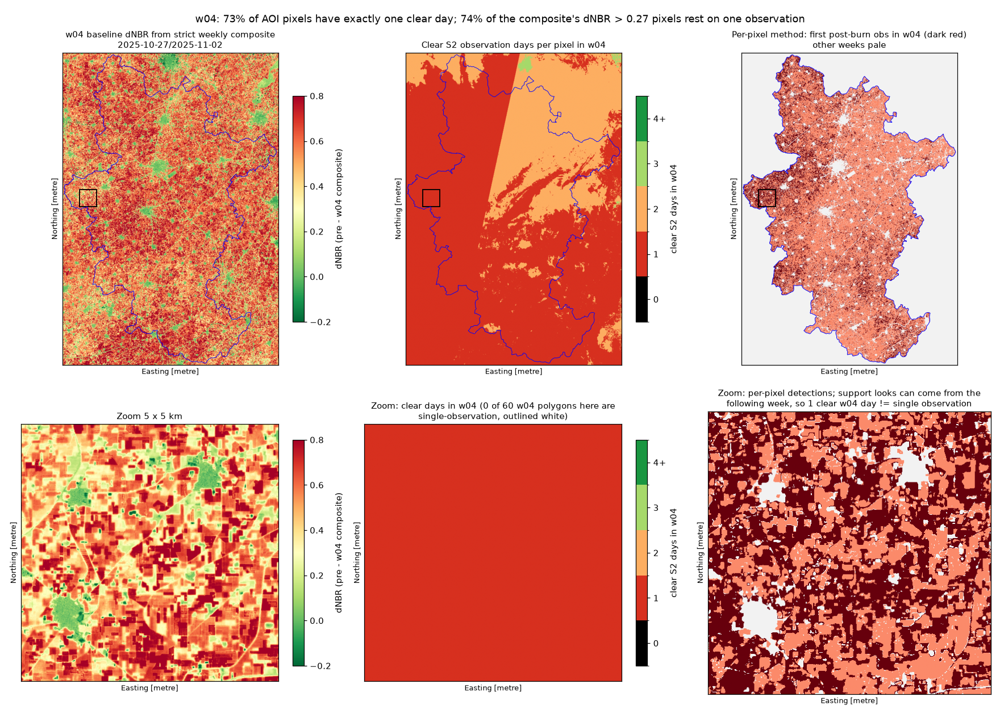
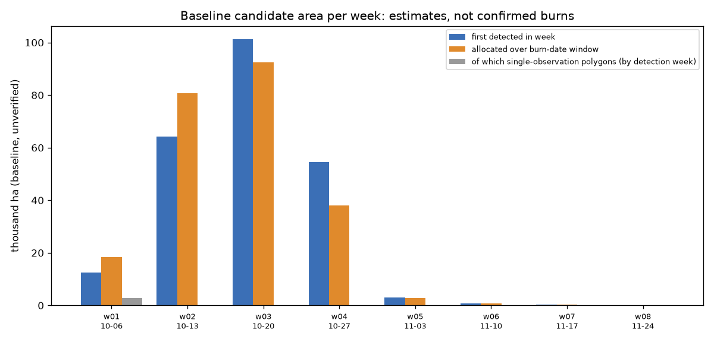
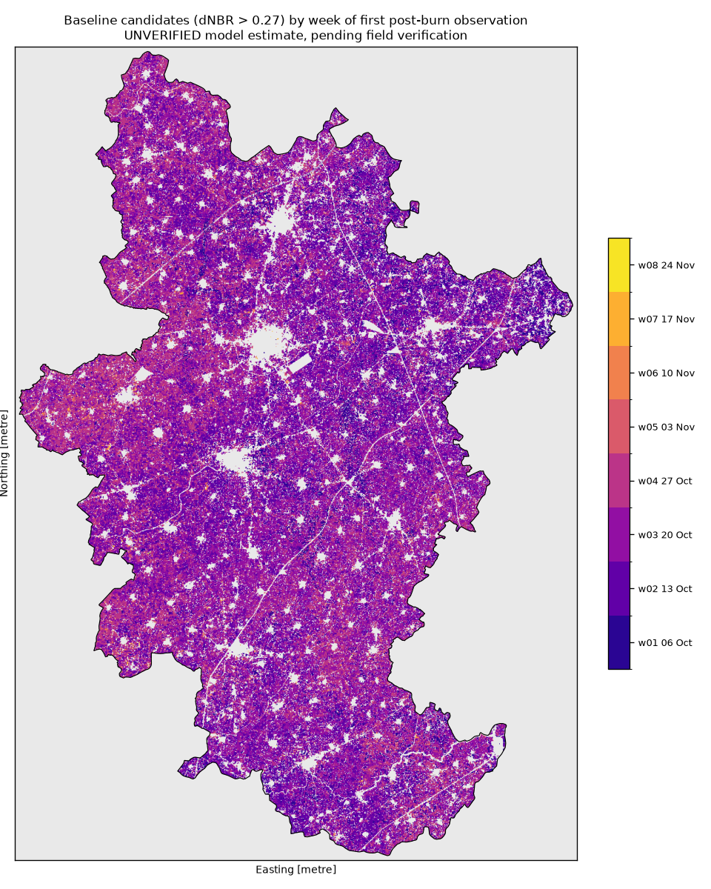
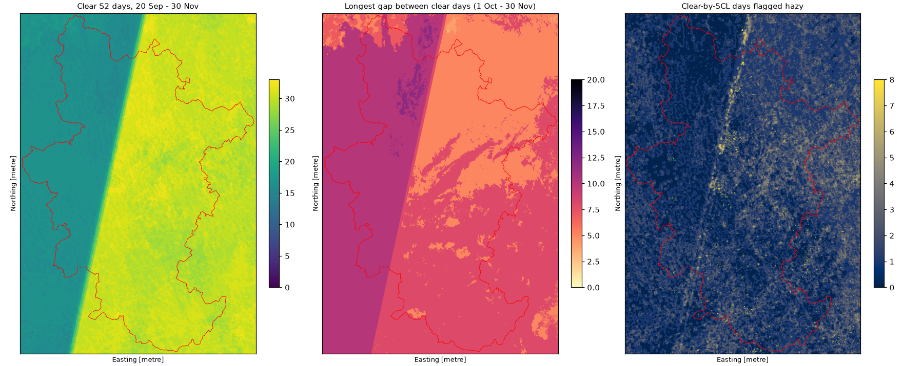
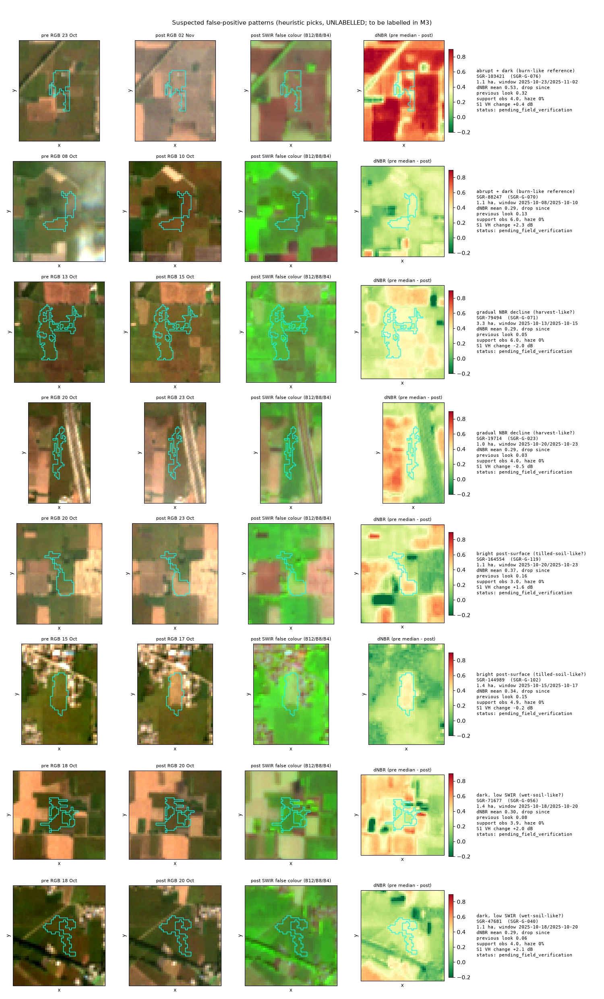

# M2: Baseline burn detection (Sangrur, 2025)

> **Decision support only.** Every polygon is a model estimate with status `pending_field_verification`. `burn_confidence` is empty until the calibrated model (M4). Nothing here is evidence of an offence.

## Method
- NBR = (B8 - B12)/(B8 + B12); dNBR = NBR_pre - NBR_obs; candidate if dNBR > **0.27**.
- **NBR_pre** = per-pixel median over clear S2 days in the pre-season window (2025-09-20 to 2025-10-05).
- **Per-pixel time series, not weekly composites.** For every pixel the first clear post-harvest day exceeding the threshold is the *first post-burn observation*; the latest clear day before it is the *last clear pre-burn observation*. The burn-date window is `[last clear pre-burn, first post-burn]`, inclusive at both ends because burning after the ~10:30 IST overpass is possible.
- Two S2 passes on the same day are merged (mean of clear passes). Clear = SCL not in [0, 1, 3, 8, 9, 10].
- Cleaning: opening with a 3x3 square, then patches < 0.1 ha (10 px) dropped. Patches are split by first post-burn observation date, so one polygon = one detection event.
- Quality bands per pixel: clear S2 days (season, pre, post, per week), days since last clear day, longest gap, hazy days. Haze = clear-by-SCL but B02 > 0.15 or within 300 m of SCL [8, 9, 10]. Carried into polygon attributes.
- Supporting observations: clear days within 10 d after first detection that also exceed the threshold. **Single-observation polygon** = at least half its pixels have only the detecting day as support.
- **Sentinel-1 is supporting evidence only**: VV/VH change (dB, same orbit direction, last acquisition on/before window start vs first on/after first post-burn day) is stored per polygon. S1 never creates or removes a candidate.

## Results
| | value |
|---|---|
| AOI area | 293,551 ha |
| Raw candidate pixels | 260,866 ha (88.9% of AOI) |
| After opening | 259,825 ha |
| **Final candidate area** | **236,566 ha (80.6% of AOI)** |
| Candidate polygons | 236,415 |
| Polygon area p50 / p90 / p99 | 0.3 / 1.99 / 10.02 ha; largest 2,840 ha |
| Single-observation polygons | 4,138 (3,068 ha) |
| Haze at detection (>= 50% px) | 6,529 ha |
| Polygons with an S1 pre/post pair | 100.0% |
| Gradual drop (NBR fell < 0.1 since previous clear day) | 59,776 ha |

### Main finding: the baseline cannot separate burning from harvest
The brief's baseline flags **81% of the district** (including settlement edges and roads that survive cleaning). Scene-wide median NBR on clear pixels falls from about 0.6 in the pre-season window (20 Sep to 5 Oct, standing paddy) to about -0.1 by November. A drop of that size exceeds 0.27 for harvested fields whether or not they were later burnt, so the first-detection date most likely tracks harvest rather than burning. Without labels (M3) this cannot be quantified. 59,776 ha of candidates show only a gradual NBR decline between consecutive clear looks, which fits harvest/senescence better than an abrupt burn. These numbers are therefore **not** a burnt-area estimate. They are the baseline M4 has to beat. `dnbr_local_mean` (drop since the previous clear look) is stored per polygon as a candidate feature for M3/M4.

## w04 (27 Oct to 2 Nov): strict composite vs observation count
- AOI pixels with 0 / 1 / 2+ clear days in w04: 0.0% / 72.52% / 27.48%.
- The strict w04 composite flags 248,410 ha with dNBR > 0.27; **73.7%** of those pixels rest on a single observation.

## Weekly summary (from per-pixel windows)
`ha_first_detected` = first post-burn observation in the week; `ha_allocated` = each pixel spread uniformly over its burn-date window; `ha_window_inside_week` = window entirely within the week.

| week | dates | ha_first_detected | ha_window_inside_week | ha_allocated | n_polygons | ha_single_observation | ha_haze_at_detection | ha_gradual_drop | median_window_days |
|---|---|---|---|---|---|---|---|---|---|
| w01 | 2025-10-06/2025-10-12 | 12,439.8 | 2,130.9 | 18,429.7 | 17212 | 2,872.2 | 4,164.6 | 3,261.8 | 3 |
| w02 | 2025-10-13/2025-10-19 | 64,240.4 | 52,601.9 | 80,830.5 | 73424 | 85.3 | 64.2 | 21,425.4 | 2 |
| w03 | 2025-10-20/2025-10-26 | 101,275.3 | 62,784 | 92,486.1 | 102807 | 35.9 | 71.2 | 33,046.2 | 2 |
| w04 | 2025-10-27/2025-11-02 | 54,436.2 | 1,274.4 | 38,048.4 | 29481 | 21.2 | 1,877.4 | 924.3 | 8 |
| w05 | 2025-11-03/2025-11-09 | 3,026.5 | 1,128.6 | 2,678.1 | 9460 | 13.9 | 351.5 | 953.1 | 2 |
| w06 | 2025-11-10/2025-11-16 | 672 | 126.2 | 721.1 | 2205 | 6.1 | 0.2 | 109.3 | 3 |
| w07 | 2025-11-17/2025-11-23 | 403.7 | 174.5 | 234 | 1508 | 9.6 | 0.1 | 49.8 | 5 |
| w08 | 2025-11-24/2025-11-30 | 72.4 | 37.4 | 56.6 | 318 | 24.2 | 0 | 6.5 | 2 |

## Quality bands

## Single-observation polygons (4,138; largest 25 shown)
Full list: `single_observation_polygons.csv`.

| field_id | grid_cell | area_ha | detected_window | n_clear_week_mean | haze_frac | dnbr_detect_mean | vh_change_db | quality_flags |
|---|---|---|---|---|---|---|---|---|
| SGR-34998 | SGR-G-028 | 66.47 | 2025-09-30/2025-10-08 | 1 | 1 | 0.34 | -0.04 | single_observation,haze_at_detection |
| SGR-99028 | SGR-G-080 | 58.46 | 2025-10-05/2025-10-08 | 2 | 1 | 0.34 | 1.28 | single_observation,haze_at_detection |
| SGR-29146 | SGR-G-029 | 48.55 | 2025-09-30/2025-10-08 | 1 | 1 | 0.36 | -0.55 | single_observation,haze_at_detection |
| SGR-155272 | SGR-G-110 | 24.42 | 2025-10-05/2025-10-08 | 2 | 1 | 0.35 | 0.51 | single_observation,haze_at_detection |
| SGR-43051 | SGR-G-038 | 21.94 | 2025-09-30/2025-10-08 | 1 | 1 | 0.34 | -0.18 | single_observation,haze_at_detection |
| SGR-146440 | SGR-G-100 | 18.62 | 2025-10-05/2025-10-08 | 2 | 1 | 0.37 | 0.05 | single_observation,haze_at_detection |
| SGR-106355 | SGR-G-080 | 15.45 | 2025-10-05/2025-10-08 | 2 | 1 | 0.35 | 1.32 | single_observation,haze_at_detection |
| SGR-134492 | SGR-G-100 | 14.41 | 2025-10-05/2025-10-08 | 2 | 1 | 0.33 | 1.29 | single_observation,haze_at_detection |
| SGR-88607 | SGR-G-066 | 12.88 | 2025-10-05/2025-10-08 | 2 | 1 | 0.3 | 1.54 | single_observation,haze_at_detection |
| SGR-103622 | SGR-G-080 | 12.74 | 2025-10-05/2025-10-08 | 2 | 1 | 0.37 | 1.26 | single_observation,haze_at_detection |
| SGR-129117 | SGR-G-090 | 12.66 | 2025-10-05/2025-10-08 | 2 | 1 | 0.35 | 1.33 | single_observation,haze_at_detection |
| SGR-145570 | SGR-G-100 | 12.25 | 2025-10-05/2025-10-08 | 2 | 1 | 0.34 | 0.86 | single_observation,haze_at_detection |
| SGR-158497 | SGR-G-110 | 11.77 | 2025-10-05/2025-10-08 | 2 | 1 | 0.37 | 0.78 | single_observation,haze_at_detection |
| SGR-74436 | SGR-G-050 | 11.34 | 2025-10-03/2025-10-08 | 1 | 1 | 0.34 | 0.61 | single_observation,haze_at_detection |
| SGR-112689 | SGR-G-078 | 11.08 | 2025-10-05/2025-10-08 | 2 | 1 | 0.35 | 0.93 | single_observation,haze_at_detection |
| SGR-144171 | SGR-G-100 | 10.95 | 2025-10-05/2025-10-08 | 2 | 1 | 0.36 | 1.16 | single_observation,haze_at_detection |
| SGR-77547 | SGR-G-050 | 10.87 | 2025-09-30/2025-10-08 | 1 | 1 | 0.32 | -0.3 | single_observation,haze_at_detection |
| SGR-141171 | SGR-G-100 | 10.81 | 2025-10-05/2025-10-08 | 2 | 1 | 0.35 | 1.08 | single_observation,haze_at_detection |
| SGR-47500 | SGR-G-046 | 10.45 | 2025-10-05/2025-10-08 | 2 | 1 | 0.38 | -0.17 | single_observation,haze_at_detection |
| SGR-135524 | SGR-G-101 | 10.29 | 2025-10-05/2025-10-08 | 2 | 1 | 0.33 | 0.99 | single_observation,haze_at_detection |
| SGR-34257 | SGR-G-029 | 10.09 | 2025-10-03/2025-10-08 | 1 | 1 | 0.37 | 0.89 | single_observation,haze_at_detection |
| SGR-149766 | SGR-G-100 | 10.05 | 2025-10-05/2025-10-08 | 2 | 1 | 0.38 | 0.48 | single_observation,haze_at_detection |
| SGR-145228 | SGR-G-099 | 9.35 | 2025-10-05/2025-10-08 | 2 | 1 | 0.36 | 1.51 | single_observation,haze_at_detection |
| SGR-124479 | SGR-G-090 | 9.35 | 2025-10-05/2025-10-08 | 2 | 1 | 0.34 | 1.58 | single_observation,haze_at_detection |
| SGR-149007 | SGR-G-102 | 9.12 | 2025-10-05/2025-10-08 | 2 | 1 | 0.34 | 1.22 | single_observation,haze_at_detection |

## Suspected false positives (unlabelled)
Picked from a random sample of 1 to 10 ha polygons using measured post-detection reflectance (`fp_sample_reflectance.csv`): darkest NIR with an abrupt drop (burn-like reference), drop since previous look < 0.05 (gradual, harvest-like), brightest red (tilled-soil-like) and darkest NIR with low SWIR (wet-soil-like). These are **hypotheses for M3 labelling**, not verified classes.

## Limitations
- 10 m pixels: mixed pixels at field edges; field bunds are not resolved, so adjacent fields with the same detection date merge into one polygon.
- Haze flag is a heuristic (blue threshold + cloud proximity); smoke-affected looks are flagged, not removed.
- No ground truth yet; no precision/recall can be reported for the baseline until M3 labels exist.

## Outputs
- `data/outputs/m2/burnt_area.tif`: burnt (0/1), week_detected (1-8), COG
- `data/outputs/m2/candidates.gpkg`: polygons + attributes (EPSG:4326)
- `data/outputs/m2/candidate_labels.tif`: polygon label raster
- `data/processed/m2/s2_pixel_detect.tif`, `s2_quality.tif`: per-pixel bands
- Every file has a `.provenance.json` sidecar.
