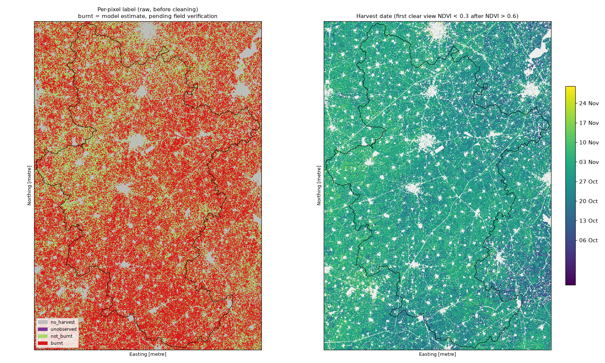
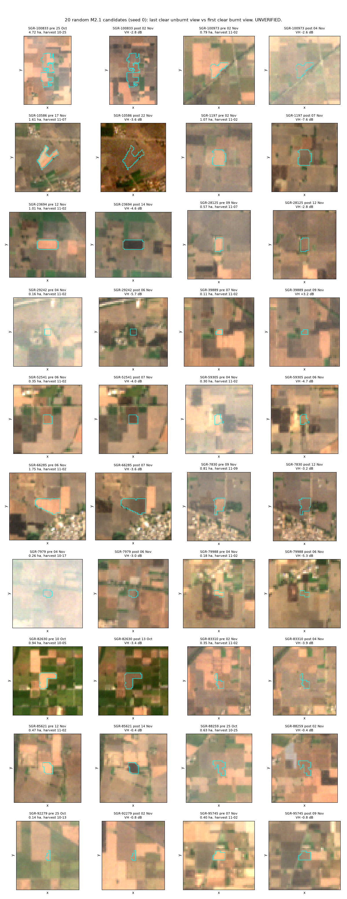
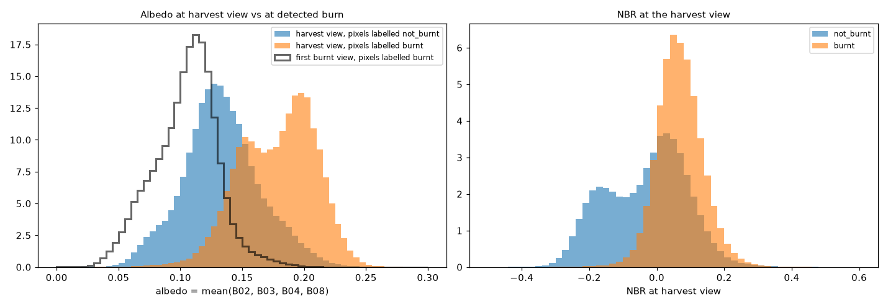

# M2.1: Harvest-aware burn detection (Sangrur, 2025)

> **Decision support only.** Every polygon is a model estimate with status `pending_field_verification` and an empty `burn_confidence` (calibration in M4). Nothing here is evidence of an offence.

Code version for all M1/M2/M2.1 outputs: `c2cb311`.

## Method (thresholds from `config.yaml`)
- **Harvest** per pixel: first usable clear view with NDVI < 0.3 after >= 1 view(s) with NDVI > 0.6.
- **Burn** tested only between *consecutive* usable views after the harvest view; all three must hold: NBR drop > 0.1, relative albedo drop > 0.15 (albedo = mean of B02, B03, B04, B08), NBR2 drop > 0.02 (NBR2 = (B11-B12)/(B11+B12)).
- **Burn-date window** = [last clear unburnt view, first clear burnt view].
- Hazy views are skipped (haze flag from M2); skipped views widen windows but never trigger a burn.
- **Labels**: `no_harvest`, `unobserved` (harvest seen, no usable view after it; never reported as not burnt), `not_burnt`, `burnt`.
- Cleaning as M2: opening r=1, patches < 0.1 ha dropped, polygons split by first burnt-view date. Sentinel-1 change stored as supporting evidence only.
- M2 baseline polygons are kept for comparison and now use IDs `SGR-B-nnnn`; M2.1 polygons use `SGR-nnnn`.

## Old vs new
| method | raw_ha | final_ha | pct_aoi | pct_harvested | n_polygons |
|---|---|---|---|---|---|
| M2 baseline (pre-season median dNBR > 0.27) | 260,865.5 | 236,566.4 | 80.6 | 95.3 | 236415 |
| M2.1 harvest-aware | 156,085.9 | 138,678.2 | 47.2 | 55.9 | 101894 |

Harvested area (any harvest label) = 248,241 ha.

## Pixel labels inside the AOI (raw, before cleaning)
| label | pixels | ha |
|---|---|---|
| no_harvest | 4,530,945 | 45,310 |
| unobserved | 25,752 | 258 |
| not_burnt | 9,189,801 | 91,898 |
| burnt | 15,608,591 | 156,086 |

**Unobserved: 25,752 pixels (258 ha).**

## Burn windows for w04
82,342 ha of cleaned candidates have a window overlapping w04; 5,196 ha have the whole window inside w04. Full table: `w04_burn_windows.csv`.

| window | days | ha | inside_w04 |
|---|---|---|---|
| 25 Oct - 02 Nov | 8 | 26,079 | False |
| 02 Nov - 07 Nov | 5 | 18,161.5 | False |
| 02 Nov - 06 Nov | 4 | 9,395.7 | False |
| 02 Nov - 04 Nov | 2 | 8,333 | False |
| 23 Oct - 02 Nov | 10 | 7,655.2 | False |
| 30 Oct - 02 Nov | 3 | 5,049.8 | True |
| 25 Oct - 30 Oct | 5 | 4,831.2 | False |
| 02 Nov - 09 Nov | 7 | 2,614.7 | False |
| 28 Oct - 02 Nov | 5 | 146.6 | True |
| 23 Oct - 28 Oct | 5 | 46.1 | False |
| 25 Oct - 04 Nov | 10 | 13.6 | False |
| 30 Oct - 06 Nov | 7 | 6 | False |

## Weekly summary
| week | dates | ha_harvested | ha_first_detected | ha_window_inside_week | ha_allocated | n_polygons | ha_single_observation | median_window_days |
|---|---|---|---|---|---|---|---|---|
| w01 | 2025-10-06/2025-10-12 | 3,006.5 | 310.2 | 57.9 | 792.6 | 613 | 1.9 | 5 |
| w02 | 2025-10-13/2025-10-19 | 18,114.4 | 2,132.1 | 1,424.9 | 2,312.3 | 3931 | 78.5 | 2 |
| w03 | 2025-10-20/2025-10-26 | 70,279 | 4,097.4 | 3,004.7 | 13,594.3 | 6055 | 169.6 | 2 |
| w04 | 2025-10-27/2025-11-02 | 120,980.4 | 43,812.6 | 5,196.5 | 41,615.2 | 23692 | 77.2 | 8 |
| w05 | 2025-11-03/2025-11-09 | 25,845.9 | 68,609.1 | 30,079.7 | 63,809.6 | 47900 | 37.3 | 2 |
| w06 | 2025-11-10/2025-11-16 | 3,859.4 | 15,057.5 | 2,144.4 | 14,359.1 | 13455 | 25.3 | 3 |
| w07 | 2025-11-17/2025-11-23 | 2,315.8 | 4,231.6 | 1,052.4 | 1,734.7 | 5300 | 111.9 | 4 |
| w08 | 2025-11-24/2025-11-30 | 819.7 | 164.8 | 95.6 | 131.4 | 948 | 46.5 | 3 |

## 20 random candidates (pre = last clear unburnt view, post = first clear burnt view)

## Threshold sensitivity (raw pixel shares, 6 sample row blocks)
Burn thresholds scaled x0.5 / x2, NDVI thresholds shifted +-0.05. Without labels the thresholds cannot be tuned; this shows how much the answer depends on them.

| variant | burnt_pct_aoi | burnt_pct_harvested | unobserved_pct_aoi | harvested_pct_aoi |
|---|---|---|---|---|
| default | 52.3 | 62.4 | 0.07 | 83.7 |
| dnbr_short_min x0.5 | 57.4 | 68.6 | 0.07 | 83.7 |
| dnbr_short_min x2 | 34.1 | 40.8 | 0.07 | 83.7 |
| albedo_rel_drop_min x0.5 | 55.6 | 66.4 | 0.07 | 83.7 |
| albedo_rel_drop_min x2 | 40.6 | 48.6 | 0.07 | 83.7 |
| dnbr2_min x0.5 | 52.6 | 62.8 | 0.07 | 83.7 |
| dnbr2_min x2 | 51 | 61 | 0.07 | 83.7 |
| ndvi_harvest -0.05 | 41.8 | 51.2 | 0.07 | 81.7 |
| ndvi_harvest +0.05 | 57.2 | 67.1 | 0.08 | 85.3 |
| ndvi_green -0.05 | 52.5 | 61.9 | 0.08 | 84.7 |
| ndvi_green +0.05 | 51.9 | 63 | 0.06 | 82.3 |

## Scene-wide change per date pair (atmosphere / illumination check)
For the date pairs that produce the most burnt area: the scene-wide median change between the two views over harvested pixels (decimated x10, clear and below the blue haze threshold on both dates), and the share of those pixels passing all three tests. A large scene-wide albedo drop means the two images differ as a whole (haze, smoke, illumination), so part of the per-pixel drop is not the field. In peak burning weeks real burns also move the scene median, so this table cannot separate the two on its own.

| pair | burnt_ha | scene_albedo_drop_rel | scene_dnbr | scene_dnbr2 | scene_pct_pass_all3 |
|---|---|---|---|---|---|
| 25 Oct -> 02 Nov | 26,079 | 0.08 | 0.17 | 0.08 | 29.7 |
| 02 Nov -> 07 Nov | 18,161.5 | 0.08 | 0.03 | 0.01 | 23.4 |
| 09 Nov -> 12 Nov | 12,902.3 | 0.02 | 0.02 | 0.02 | 7.6 |
| 07 Nov -> 09 Nov | 12,713.2 | -0.06 | -0 | 0.01 | 6.9 |
| 04 Nov -> 06 Nov | 10,402.1 | 0.11 | 0.01 | 0.01 | 12 |
| 02 Nov -> 06 Nov | 9,395.7 | 0 | 0.02 | 0.01 | 17.1 |
| 02 Nov -> 04 Nov | 8,333 | -0.17 | -0 | -0.01 | 7.7 |
| 23 Oct -> 02 Nov | 7,655.2 | -0.1 | 0.24 | 0.08 | 20.7 |
| 30 Oct -> 02 Nov | 5,049.8 | 0.01 | 0.02 | 0.03 | 10.1 |
| 25 Oct -> 30 Oct | 4,831.2 | 0.01 | 0.1 | 0.04 | 13.4 |
| 06 Nov -> 07 Nov | 4,722 | 0.06 | -0.01 | -0 | 3.5 |
| 02 Nov -> 09 Nov | 2,614.7 | 0.07 | 0.05 | 0.04 | 28.5 |
| 12 Nov -> 14 Nov | 2,144.4 | -0.12 | -0.02 | -0.02 | 1.7 |
| 06 Nov -> 09 Nov | 2,029.5 | 0.03 | -0.01 | 0.01 | 10.6 |
| 20 Oct -> 23 Oct | 2,001.2 | -0.12 | 0.05 | 0.03 | 1.4 |

## Diagnostics and caveats
- Haze leak: the blue threshold (0.15) only removes part of the smoky 4 Nov scene; several random chips use visibly hazy 4 Nov views as the unburnt reference. A hazy -> clear transition lowers albedo, NBR and NBR2 together.
- Median albedo at the first burnt view: 0.1068; at the harvest view of `not_burnt` pixels: 0.1317. 18.3% of `not_burnt` pixels already had a harvest view darker than the median burnt view. Some of these may be burns that happened between the last green view and the harvest view, which this method cannot see (the harvest view is the first post-harvest reference).
- Tillage that incorporates straw can lower NBR, albedo and NBR2 together, like a burn. The three-way test reduces but does not remove that confusion; M3 labels (`tilled_not_burnt`) are needed to measure it.
- `no_harvest` includes settlements, roads, water, orchards and fields not green in the pre-season window.
- Polygon area p50 / p90 / p99: 0.51 / 2.98 / 13.16 ha; largest 237 ha.
- 1,448 single-observation polygons (548 ha).

## Outputs
- `data/processed/m21/s2_harvest_burn.tif`: per-pixel label, harvest and burn dates, index drops (x10000)
- `data/outputs/m21/burnt_area.tif`, `candidate_labels.tif`, `candidates.gpkg`
- Every file has a `.provenance.json` sidecar.
