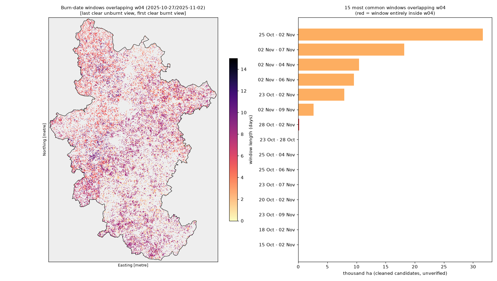

# M2.1: Harvest-aware burn detection (Sangrur, 2025)

> **Decision support only.** Every polygon is a model estimate with status `pending_field_verification` and an empty `burn_confidence` (calibration in M4). Nothing here is evidence of an offence.

Code version for all M1/M2/M2.1 outputs: `3825483`.

## Method (thresholds from `config.yaml`)
- **Harvest** per pixel: first usable clear view with NDVI < 0.3 after >= 1 view(s) with NDVI > 0.6.
- **Burn** tested only between *consecutive* usable views after the harvest view; all three must hold: NBR drop > 0.1, relative albedo drop > 0.15 (albedo = mean of B02, B03, B04, B08), NBR2 drop > 0.02 (NBR2 = (B11-B12)/(B11+B12)).
- **Burn-date window** = [last clear unburnt view, first clear burnt view].
- Hazy views are skipped: blue B02 > 0.15, within 300 m of SCL cloud, or Sen2Cor AOT > 0.6. Skipped views widen windows but never trigger a burn. s2cloudless is not used (needs L1C bands incl. B10, not in the PC L2A collection).
- **Scene rule** (fixed before the run): a date is dropped if < 20% of its SCL-clear AOI pixels survive the haze mask, or its PIF residual spread exceeds 3x the median. Dropped: 2025-10-30, 2025-11-22.
- **Radiometric normalisation**: per acquisition and band, the median deviation of 84,724 pseudo-invariant pixels (WorldCover classes [50, 60], eroded 1 px, NDVI max < 0.3, relative spread < 0.15) from their season median is subtracted before any index.
- **Early burns**: if the first non-green view already has NBR <= -0.24 and albedo <= 0.09 (p25 of the frozen M2.1 burns), the pixel is `harvest_and_burn_same_window` with window [last green view, that view]; otherwise the interval before the first post-harvest view stays unobserved for burning.
- **Labels**: `no_harvest`, `unobserved` (harvest seen, no usable view after it; never reported as not burnt), `not_burnt`, `burnt`, `harvest_and_burn_same_window`.
- Cleaning as M2: opening r=1, patches < 0.1 ha dropped, polygons split by first burnt-view date. Sentinel-1 change stored as supporting evidence only.
- M2 baseline polygons are kept for comparison and now use IDs `SGR-B-nnnn`; M2.1 polygons use `SGR-nnnn`.

## Old vs new
| method | raw_ha | final_ha | pct_aoi | pct_harvested | n_polygons |
|---|---|---|---|---|---|
| M2 baseline (pre-season median dNBR > 0.27) | 260,865.5 | 236,566.4 | 80.6 | 94.8 | 236415 |
| M2.1 frozen (a753719: blue haze test, no normalisation) | 156,085.9 | 138,678.2 | 47.2 | 55.9 | 101894 |
| M2.1 + AOT haze mask + PIF normalisation + early burns | 152,834.1 | 135,979.3 | 46.3 | 54.5 | 97137 |

**Flagged after fixes: 46.3% of the AOI.** Early burns (`harvest_and_burn_same_window`): 672 polygons, 288 ha.

## Haze loss per scene
Shares of the scene's SCL-clear AOI pixels removed by each test (tests overlap; `aot_only` = removed by AOT and by neither older test). Full table: `haze_loss_per_scene.csv`.

| file | scl_clear_pct_aoi | blue_pct | cloud_buffer_pct | aot_pct | aot_only_pct | hazy_pct | usable_pct | aot_p10 | aot_p50 | aot_p90 | excluded |
|---|---|---|---|---|---|---|---|---|---|---|---|
| 20250920_s2b.tif | 62.9 | 1.9 | 5.2 | 0 | 0 | 6.8 | 93.2 | 0.41 | 0.46 | 0.46 | False |
| 20250923_s2b.tif | 100 | 0.6 | 0 | 0 | 0 | 0.6 | 99.4 | 0.19 | 0.21 | 0.23 | False |
| 20250925_s2c.tif | 67.1 | 1.6 | 0.6 | 0 | 0 | 2.1 | 97.9 | 0.26 | 0.35 | 0.35 | False |
| 20250927_s2a.tif | 66.7 | 1.1 | 1.5 | 0 | 0 | 2.6 | 97.4 | 0.39 | 0.44 | 0.46 | False |
| 20250928_s2c.tif | 88.1 | 1.9 | 10 | 1.4 | 1.4 | 11.7 | 88.3 | 0.3 | 0.33 | 0.39 | False |
| 20250930_s2a.tif | 95.2 | 0.9 | 5.2 | 0 | 0 | 5.8 | 94.2 | 0.45 | 0.5 | 0.54 | False |
| 20250930_s2b.tif | 63.8 | 1.4 | 5.9 | 8.2 | 5.4 | 12.4 | 87.6 | 0.48 | 0.5 | 0.53 | False |
| 20251003_s2b.tif | 49.5 | 12.7 | 72.3 | 1.4 | 0.4 | 73.2 | 26.8 | 0.32 | 0.32 | 0.55 | False |
| 20251005_s2c.tif | 67.5 | 0.9 | 0.2 | 0 | 0 | 1.1 | 98.9 | 0.46 | 0.48 | 0.49 | False |
| 20251008_s2c.tif | 73.7 | 2.3 | 15.8 | 0 | 0 | 16.3 | 83.7 | 0.41 | 0.43 | 0.47 | False |
| 20251010_s2b.tif | 65.1 | 1.4 | 0.5 | 0 | 0 | 1.9 | 98.1 | 0.47 | 0.51 | 0.51 | False |
| 20251013_s2b.tif | 100 | 0.7 | 0 | 0 | 0 | 0.7 | 99.3 | 0.42 | 0.43 | 0.45 | False |
| 20251015_s2c.tif | 65.3 | 0.8 | 0.4 | 0 | 0 | 1.1 | 98.9 | 0.47 | 0.57 | 0.57 | False |
| 20251017_s2a.tif | 66.2 | 0.7 | 0.3 | 0 | 0 | 0.9 | 99.1 | 0.52 | 0.52 | 0.53 | False |
| 20251018_s2c.tif | 100 | 0.5 | 0 | 0 | 0 | 0.5 | 99.5 | 0.47 | 0.49 | 0.5 | False |
| 20251020_s2a.tif | 100 | 0.3 | 0 | 0 | 0 | 0.3 | 99.7 | 0.38 | 0.38 | 0.4 | False |
| 20251020_s2b.tif | 66.6 | 0.7 | 0.2 | 0 | 0 | 0.9 | 99.1 | 0.46 | 0.46 | 0.59 | False |
| 20251023_s2b.tif | 100 | 0.4 | 0 | 0 | 0 | 0.4 | 99.6 | 0.54 | 0.54 | 0.54 | False |
| 20251025_s2c.tif | 67.4 | 0.7 | 0.3 | 0 | 0 | 1 | 99 | 0.27 | 0.29 | 0.31 | False |
| 20251028_s2c.tif | 1.4 | 0.1 | 35.9 | 0 | 0 | 35.9 | 64.1 | 0.52 | 0.53 | 0.54 | False |
| 20251030_s2b.tif | 26.1 | 2.4 | 19.8 | 0 | 0 | 21 | 79 | 0.39 | 0.41 | 0.44 | True |
| 20251102_s2b.tif | 100 | 0.3 | 0 | 0 | 0 | 0.3 | 99.7 | 0.49 | 0.51 | 0.54 | False |
| 20251104_s2c.tif | 67.9 | 35.4 | 1.9 | 0 | 0 | 36.6 | 63.4 | 0.5 | 0.54 | 0.56 | False |
| 20251106_s2a.tif | 66.1 | 0.5 | 0.3 | 0 | 0 | 0.7 | 99.3 | 0.23 | 0.25 | 0.3 | False |
| 20251107_s2c.tif | 99.6 | 0.3 | 7.3 | 0 | 0 | 7.6 | 92.4 | 0.14 | 0.16 | 0.17 | False |
| 20251109_s2a.tif | 100 | 0.3 | 0 | 0 | 0 | 0.3 | 99.7 | 0.19 | 0.21 | 0.22 | False |
| 20251109_s2b.tif | 64.6 | 0.6 | 0.6 | 0 | 0 | 1.2 | 98.8 | 0.18 | 0.2 | 0.21 | False |
| 20251112_s2b.tif | 100 | 0.3 | 0 | 0 | 0 | 0.3 | 99.7 | 0.35 | 0.4 | 0.45 | False |
| 20251114_s2c.tif | 67.1 | 0.5 | 0.3 | 0 | 0 | 0.7 | 99.3 | 0.27 | 0.28 | 0.3 | False |
| 20251117_s2c.tif | 100 | 0.3 | 0 | 0 | 0 | 0.3 | 99.7 | 0.35 | 0.36 | 0.38 | False |
| 20251119_s2b.tif | 64.7 | 0.4 | 0.6 | 0 | 0 | 1 | 99 | 0.47 | 0.48 | 0.49 | False |
| 20251122_s2b.tif | 100 | 0.1 | 0 | 100 | 99.9 | 100 | 0 | 0.82 | 0.88 | 0.92 | True |
| 20251124_s2c.tif | 68.7 | 0.3 | 0.2 | 0 | 0 | 0.5 | 99.5 | 0.36 | 0.38 | 0.41 | False |
| 20251126_s2a.tif | 66 | 0.3 | 0.2 | 0 | 0 | 0.5 | 99.5 | 0.37 | 0.38 | 0.39 | False |
| 20251127_s2c.tif | 100 | 0.2 | 0 | 0 | 0 | 0.2 | 99.8 | 0.36 | 0.37 | 0.38 | False |
| 20251129_s2a.tif | 100 | 0.2 | 0 | 0 | 0 | 0.2 | 99.8 | 0.17 | 0.17 | 0.18 | False |
| 20251129_s2b.tif | 62.8 | 0.5 | 0.2 | 0 | 0 | 0.7 | 99.3 | 0.18 | 0.18 | 0.25 | False |

**4 Nov**: 36.6% of SCL-clear pixels masked (0.0 points by AOT alone), 63.4% usable; kept.

Sen2Cor AOT is close to constant inside each scene: median per-scene p10-p90 width 0.04 (max 0.23). It works as a scene-level haze indicator, not a per-pixel smoke-plume mask, so it cannot catch local smoke; the blue test and the scene rule do the per-pixel and per-date work.

## Radiometric offsets (reflectance, subtracted)
`spread_*` = PIF residual spread after removing the offset. Full table: `radiometric_offsets.csv`.

| file | n_pif_usable | applied | off_B02 | off_B03 | off_B04 | off_B08 | off_B11 | off_B12 |
|---|---|---|---|---|---|---|---|---|
| 20250920_s2b.tif | 26887 | True | 0.02 | 0.02 | 0.02 | 0.03 | 0.04 | 0.03 |
| 20250923_s2b.tif | 75443 | True | 0 | 0 | 0 | 0.01 | 0.01 | 0.01 |
| 20250925_s2c.tif | 33362 | True | 0.01 | 0.02 | 0.02 | 0.03 | 0.04 | 0.02 |
| 20250927_s2a.tif | 37708 | True | 0.01 | 0.02 | 0.02 | 0.02 | 0.04 | 0.02 |
| 20250928_s2c.tif | 58898 | True | 0.01 | 0.01 | -0.01 | 0.03 | 0.02 | 0.01 |
| 20250930_s2a.tif | 67393 | True | 0 | 0.01 | 0.01 | 0 | 0.02 | 0.01 |
| 20250930_s2b.tif | 31694 | True | 0.01 | 0.01 | 0.01 | 0.02 | 0.04 | 0.04 |
| 20251003_s2b.tif | 6784 | True | 0.02 | 0.01 | -0 | 0.04 | 0.02 | 0.02 |
| 20251005_s2c.tif | 43098 | True | 0 | 0.01 | 0.02 | 0.02 | 0.04 | 0.02 |
| 20251008_s2c.tif | 47466 | True | -0.01 | -0.01 | -0.01 | -0.01 | -0.01 | -0.03 |
| 20251010_s2b.tif | 34721 | True | 0.01 | 0.01 | 0.01 | 0.01 | 0.02 | 0.02 |
| 20251013_s2b.tif | 73915 | True | -0 | 0 | 0 | -0 | 0 | 0.01 |
| 20251015_s2c.tif | 43627 | True | 0 | 0.01 | 0.01 | 0.02 | 0.03 | 0.01 |
| 20251017_s2a.tif | 46141 | True | 0 | 0 | 0.01 | 0.01 | 0.02 | 0.01 |
| 20251018_s2c.tif | 78620 | True | -0.01 | -0 | 0 | -0.01 | 0.01 | 0 |
| 20251020_s2a.tif | 82458 | True | -0.01 | -0.01 | -0 | -0.01 | 0 | -0 |
| 20251020_s2b.tif | 45465 | True | 0 | 0 | 0.01 | 0 | 0.02 | 0.02 |
| 20251023_s2b.tif | 80922 | True | -0 | -0 | 0 | 0 | 0 | 0.01 |
| 20251025_s2c.tif | 45609 | True | 0.01 | 0.01 | 0.01 | 0.01 | 0.02 | 0.01 |
| 20251028_s2c.tif | 1931 | True | -0.01 | -0.01 | -0.01 | -0.01 | -0.01 | -0.02 |
| 20251030_s2b.tif | 14152 | True | 0.01 | 0.01 | 0.01 | 0 | 0.02 | 0.02 |
| 20251102_s2b.tif | 82938 | True | 0.01 | 0 | 0 | -0 | -0 | 0 |
| 20251104_s2c.tif | 17047 | True | 0.02 | 0.02 | 0.02 | 0.02 | 0.03 | 0.01 |
| 20251106_s2a.tif | 49229 | True | 0 | 0 | 0 | 0 | -0 | -0 |
| 20251107_s2c.tif | 77275 | True | -0 | -0.01 | -0.01 | -0.01 | -0.01 | -0.02 |
| 20251109_s2a.tif | 83394 | True | 0 | -0 | -0.01 | -0.01 | -0.02 | -0.02 |
| 20251109_s2b.tif | 45351 | True | 0.01 | 0 | 0 | 0 | -0.01 | 0 |
| 20251112_s2b.tif | 81852 | True | -0 | -0 | -0 | -0 | -0.02 | -0.01 |
| 20251114_s2c.tif | 50253 | True | 0 | 0 | 0 | 0 | -0 | -0 |
| 20251117_s2c.tif | 82465 | True | -0 | -0 | -0 | -0.01 | -0.02 | -0.02 |
| 20251119_s2b.tif | 48477 | True | 0 | -0 | -0 | -0 | -0 | 0 |
| 20251122_s2b.tif | 0 | False | 0 | 0 | 0 | 0 | 0 | 0 |
| 20251124_s2c.tif | 53983 | True | -0.01 | -0.01 | -0 | -0 | -0.01 | -0.01 |
| 20251126_s2a.tif | 51285 | True | -0.01 | -0.01 | -0 | -0 | -0.01 | -0.01 |
| 20251127_s2c.tif | 84338 | True | -0.02 | -0.01 | -0.01 | -0.02 | -0.02 | -0.02 |
| 20251129_s2a.tif | 83960 | True | -0.01 | -0.01 | -0.01 | -0.02 | -0.03 | -0.03 |
| 20251129_s2b.tif | 44535 | True | 0 | -0 | -0 | -0 | -0.01 | -0 |

Harvested area (any harvest label) = 249,606 ha.

## Pixel labels inside the AOI (raw, before cleaning)
| label | pixels | ha |
|---|---|---|
| no_harvest | 4,394,508 | 43,945 |
| unobserved | 28,316 | 283 |
| not_burnt | 9,648,853 | 96,488 |
| burnt | 15,155,239 | 151,552 |
| harvest_and_burn_same_window | 128,173 | 1,282 |

**Unobserved: 28,316 pixels (283 ha).**

## Burn windows for w04
80,637 ha of cleaned candidates have a window overlapping w04; 166 ha have the whole window inside w04. Full table: `w04_burn_windows.csv`.

| window | days | ha | inside_w04 |
|---|---|---|---|
| 25 Oct - 02 Nov | 8 | 31,678.1 | False |
| 02 Nov - 07 Nov | 5 | 18,195.7 | False |
| 02 Nov - 04 Nov | 2 | 10,428.5 | False |
| 02 Nov - 06 Nov | 4 | 9,545.8 | False |
| 23 Oct - 02 Nov | 10 | 7,919.6 | False |
| 02 Nov - 09 Nov | 7 | 2,610.2 | False |
| 28 Oct - 02 Nov | 5 | 165.6 | True |
| 23 Oct - 28 Oct | 5 | 67.5 | False |
| 25 Oct - 04 Nov | 10 | 18.6 | False |
| 25 Oct - 06 Nov | 12 | 5.3 | False |
| 23 Oct - 07 Nov | 15 | 1.2 | False |
| 20 Oct - 02 Nov | 13 | 0.5 | False |

## Weekly summary
| week | dates | ha_harvested | ha_first_detected | ha_window_inside_week | ha_allocated | n_polygons | ha_single_observation | median_window_days |
|---|---|---|---|---|---|---|---|---|
| w01 | 2025-10-06/2025-10-12 | 2,629.3 | 321.1 | 47.9 | 761.4 | 607 | 5.1 | 5 |
| w02 | 2025-10-13/2025-10-19 | 16,196.9 | 2,132.5 | 1,465.3 | 2,282.2 | 3879 | 97.4 | 2 |
| w03 | 2025-10-20/2025-10-26 | 69,406.4 | 4,645.6 | 3,642.2 | 13,946 | 6861 | 185.2 | 2 |
| w04 | 2025-10-27/2025-11-02 | 124,665.8 | 39,831.4 | 165.6 | 38,626.1 | 19903 | 8.2 | 8 |
| w05 | 2025-11-03/2025-11-09 | 25,978.4 | 69,479.8 | 28,674.3 | 63,900.2 | 46954 | 31 | 2 |
| w06 | 2025-11-10/2025-11-16 | 4,213.2 | 15,076.5 | 2,339.6 | 14,498.4 | 13297 | 48 | 3 |
| w07 | 2025-11-17/2025-11-23 | 2,000.5 | 3,537.4 | 267.4 | 1,255 | 3813 | 25.4 | 3 |
| w08 | 2025-11-24/2025-11-30 | 1,211.5 | 534.9 | 91.4 | 211 | 1823 | 56 | 5 |

## 20 random candidates (pre = last clear unburnt view, post = first clear burnt view)

## Threshold sensitivity (raw pixel shares, 6 sample row blocks)
Burn thresholds scaled x0.5 / x2, NDVI thresholds shifted +-0.05. Without labels the thresholds cannot be tuned; this shows how much the answer depends on them.

| variant | burnt_pct_aoi | burnt_pct_harvested | unobserved_pct_aoi | harvested_pct_aoi |
|---|---|---|---|---|
| default | 51.4 | 61.1 | 0.07 | 84.1 |
| dnbr_short_min x0.5 | 55.2 | 65.7 | 0.07 | 84.1 |
| dnbr_short_min x2 | 35.3 | 42 | 0.07 | 84.1 |
| albedo_rel_drop_min x0.5 | 55.1 | 65.5 | 0.07 | 84.1 |
| albedo_rel_drop_min x2 | 39.5 | 47 | 0.07 | 84.1 |
| dnbr2_min x0.5 | 51.7 | 61.5 | 0.07 | 84.1 |
| dnbr2_min x2 | 50.6 | 60.2 | 0.07 | 84.1 |
| ndvi_harvest -0.05 | 40.8 | 49.8 | 0.07 | 82 |
| ndvi_harvest +0.05 | 56.5 | 65.8 | 0.08 | 85.8 |
| ndvi_green -0.05 | 51.6 | 60.7 | 0.08 | 84.9 |
| ndvi_green +0.05 | 51.2 | 61.6 | 0.07 | 83.1 |

## Scene-wide change per date pair (atmosphere / illumination check)
For the date pairs that produce the most burnt area: the scene-wide median change between the two views over harvested pixels (decimated x10, clear and below the blue haze threshold on both dates), and the share of those pixels passing all three tests. A large scene-wide albedo drop means the two images differ as a whole (haze, smoke, illumination), so part of the per-pixel drop is not the field. In peak burning weeks real burns also move the scene median, so this table cannot separate the two on its own.

| pair | burnt_ha | scene_albedo_drop_rel | scene_dnbr | scene_dnbr2 | scene_pct_pass_all3 |
|---|---|---|---|---|---|
| 25 Oct -> 02 Nov | 31,678.1 | 0.08 | 0.17 | 0.08 | 29.6 |
| 02 Nov -> 07 Nov | 18,195.7 | 0.08 | 0.03 | 0.01 | 23.3 |
| 07 Nov -> 09 Nov | 13,081.4 | -0.06 | -0 | 0.01 | 6.9 |
| 09 Nov -> 12 Nov | 12,725.1 | 0.02 | 0.02 | 0.02 | 7.6 |
| 02 Nov -> 04 Nov | 10,428.5 | -0.17 | -0 | -0.01 | 7.7 |
| 02 Nov -> 06 Nov | 9,545.8 | 0 | 0.02 | 0.01 | 17 |
| 04 Nov -> 06 Nov | 8,302.7 | 0.11 | 0.01 | 0.01 | 12 |
| 23 Oct -> 02 Nov | 7,919.6 | -0.1 | 0.24 | 0.08 | 20.6 |
| 06 Nov -> 07 Nov | 5,032 | 0.06 | -0.01 | -0 | 3.5 |
| 02 Nov -> 09 Nov | 2,610.2 | 0.07 | 0.05 | 0.04 | 28.4 |
| 12 Nov -> 14 Nov | 2,339.6 | -0.12 | -0.02 | -0.02 | 1.7 |
| 20 Oct -> 23 Oct | 2,075.8 | -0.12 | 0.05 | 0.03 | 1.4 |
| 06 Nov -> 09 Nov | 2,075.3 | 0.03 | -0.01 | 0.01 | 10.5 |
| 12 Nov -> 17 Nov | 1,849.2 | -0.03 | -0.03 | -0.03 | 3.6 |
| 23 Oct -> 25 Oct | 1,559.8 | -0.14 | 0.04 | -0 | 0.9 |

## Diagnostics and caveats
- The date-pair table above applies only the blue haze test at its decimated scale (no AOT, no offsets), so it describes the raw imagery, not the corrected inputs.
- Median albedo at the first burnt view: 0.1072; at the harvest view of `not_burnt` pixels: 0.1289. 19.1% of `not_burnt` pixels already had a harvest view darker than the median burnt view. Some of these may be burns that happened between the last green view and the harvest view, which this method cannot see (the harvest view is the first post-harvest reference).
- Tillage that incorporates straw can lower NBR, albedo and NBR2 together, like a burn. The three-way test reduces but does not remove that confusion; M3 labels (`tilled_not_burnt`) are needed to measure it.
- `no_harvest` includes settlements, roads, water, orchards and fields not green in the pre-season window.
- Polygon area p50 / p90 / p99: 0.53 / 3.05 / 13.61 ha; largest 181 ha.
- 1,138 single-observation polygons (456 ha).

## Outputs
- `data/processed/m21/s2_harvest_burn.tif`: per-pixel label, harvest and burn dates, index drops (x10000)
- `data/outputs/m21/burnt_area.tif`, `candidate_labels.tif`, `candidates.gpkg`
- Every file has a `.provenance.json` sidecar.
