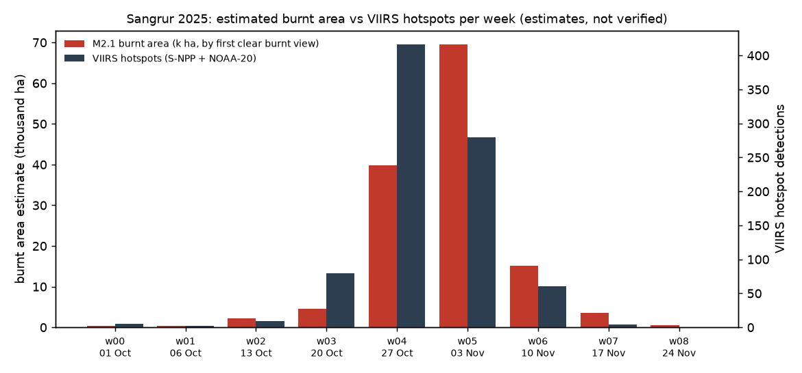

# M5-lite: estimated burnt area vs VIIRS hotspots (Sangrur, 1 Oct - 30 Nov 2025)

> **Research prototype, decision support only.** Burnt area is an uncalibrated estimate from
> threshold rules (M2.1; every polygon is `pending_field_verification`). Hotspot counts are
> satellite fire detections. Neither is evidence that any person or field burned residue.

Produced by `stubble firms-fetch` and `stubble m5lite`. Outputs: `data/outputs/m5lite/`
(`grid_week.csv`, `grid_season.csv/.geojson`, `weekly.csv`, `summary.json`), figures in this
folder.

## Data
- **Burnt area:** M2.1 harvest-aware detection, 97,137 polygons, 135,979 ha. Each polygon is
  given the week of its first clear burnt view (`detect_date`). 331 polygons (133 ha) first seen
  before 1 Oct are outside the season, which leaves **135,835 ha**.
- **Hotspots:** NASA FIRMS VIIRS 375 m active fire, standard-processing archive
  (`VIIRS_SNPP_SP`, `VIIRS_NOAA20_SP`), fetched in 5-day requests for the AOI bounding box, then
  clipped to the district polygon. **857 detections** (S-NPP 420, NOAA-20 437). Duplicates
  between the two satellites are not merged: one fire can appear in both.
- **Grid:** 162 cells of 5 km. **Weeks:** w00 = 1-5 Oct, then w01 to w08 are 7-day windows from
  6 Oct (w08 = 24-30 Nov).

## Weekly
| week | dates | M2.1 burnt ha (estimate) | VIIRS hotspots |
|---|---|---|---|
| w00 | 1-5 Oct | 287 | 5 |
| w01 | 6-12 Oct | 321 | 2 |
| w02 | 13-19 Oct | 2,132 | 9 |
| w03 | 20-26 Oct | 4,646 | 80 |
| w04 | 27 Oct - 2 Nov | 39,829 | 416 |
| w05 | 3-9 Nov | 69,473 | 280 |
| w06 | 10-16 Nov | 15,076 | 61 |
| w07 | 17-23 Nov | 3,537 | 4 |
| w08 | 24-30 Nov | 535 | 0 |
| **season** | | **135,835** | **857** |

## Findings (estimates, with caveats)
1. **The two sources broadly agree on where burning happened.** Per 5 km cell the Spearman rank
   correlation is 0.55. Both concentrate in the centre and south of the district
   (`grid_maps.png`, `cell_scatter.png`).
2. **The estimated area is large relative to the hotspot count.** The season ratio is about
   **159 ha of estimated burnt area per VIIRS detection**. A VIIRS detection is a 375 m pixel
   seen at two moments a day, not an area measurement, so the ratio is not a measure of
   undercounting. It shows that a hotspot count cannot be read as area.
3. **Hotspots peak one week before the area estimate does** (w04 vs w05). This fits the
   observation gaps in Sentinel-2. The 28 Oct scene was only 1.4 % SCL-clear over the AOI, and
   the 30 Oct scene was excluded by the pre-set scene rule (M2.1 report). Late-October burns are
   therefore first seen on 2 Nov or later and counted in w04 or w05. `detect_date` is the first
   clear view after the burn, not the burn date.
4. **VIIRS samples two times of day only.** 852 of 857 detections are from 12:00-14:59 IST, and
   5 are from 01:00-02:59 IST (`hotspot_hours_ist.png`). A fire burning and going out between
   these passes cannot be detected. A burn scar stays visible for days, which is the case for
   burnt-area mapping. These data alone do not show how much burning happens off-pass.
5. **Cells with the largest mismatch.** The most negative cells (share of hotspots well below
   share of estimated area) are SGR-G-127, -124, -117, -043 and -107. Each has 1,284-1,486 ha
   estimated and 1-2 hotspots. The most positive cells are SGR-G-053, -080, -038, -111 and -149,
   with 18-29 hotspots on 800-1,250 ha. Full ranking: `summary.json`. A mismatch can come from
   off-pass burning, false positives in M2.1 (e.g. tilled or wet soil), small or short fires
   below the VIIRS detection limit, or cloud and haze. It is a prompt for field checks, not a
   finding about any village.
6. **West vs east.** West: 69,321 ha, 414 hotspots, 85 cells. East: 66,514 ha, 443 hotspots,
   77 cells. M2.1 polygons in the west average 21.2 clear Sentinel-2 views against 30.1 in the
   east. Fewer views mean wider burn-date windows and a higher chance of missing short-lived
   scars, so west-side estimates are less certain.

## How far to trust the area estimate (from the M3 validation sample)
The 200 blind-labelled items (after two review rounds, design-weighted to the sample frame) give
only an **indicative** check:
- M2.1 polygons labelled burnt: 76 % by count, 90 % by area.
- Unflagged cropland 1 ha cells labelled burnt: 38 %, suggesting M2.1 also misses burns.

The labeller agreed with their own hidden repeats only 55 % of the time (kappa 0.17, 20 pairs).
Labels moved strongly toward "burnt" across review rounds, so these shares are uncertain and are
not used to adjust the area. No NRSC (ISRO) figure is used here.

## Not done (future work)
Merging S-NPP and NOAA-20 duplicates; MODIS and NOAA-21; per-village units; calibrated
confidence (M4); a re-test of label reliability.
